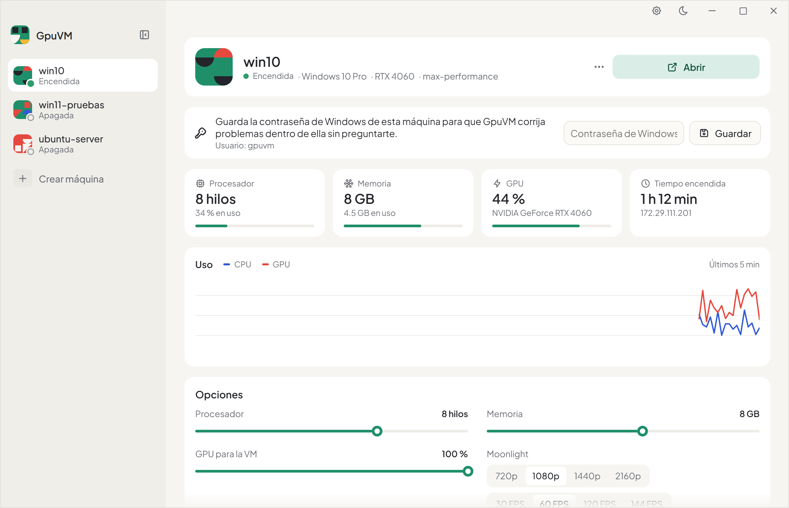
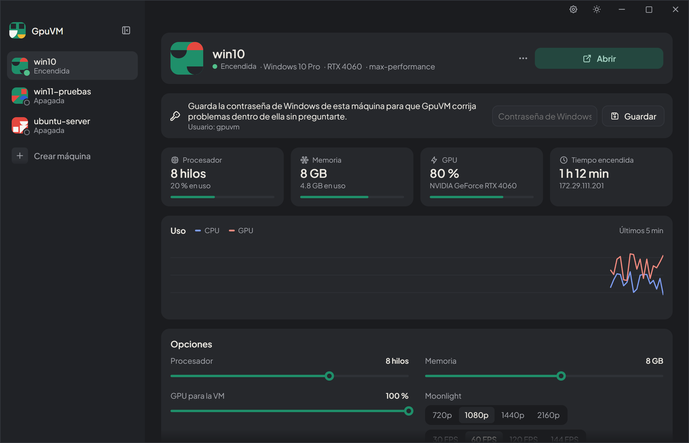
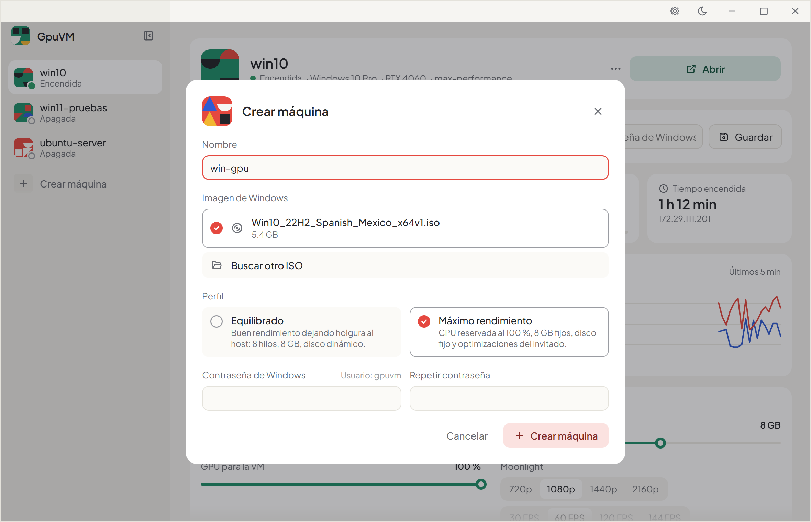
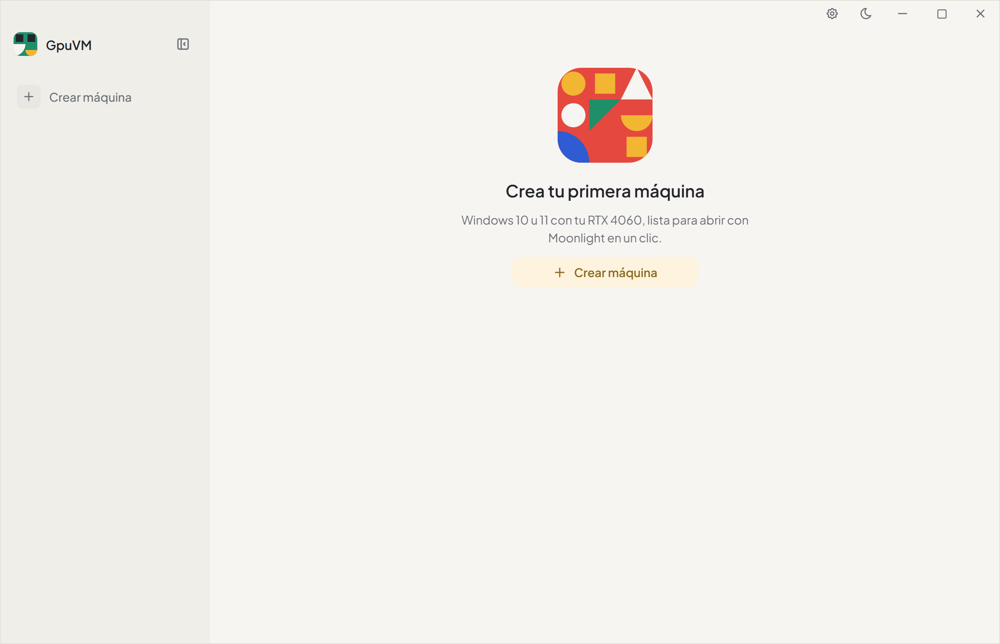

[English](README.md) | Español

<p align="center">
  
</p>

<h1 align="center">GpuVM</h1>

<p align="center">
  Máquinas virtuales Windows 10/11 que usan tu propia GPU: se crean, se encienden y se abren en un clic.
</p>

<p align="center">
  <a href="https://github.com/alenj0x1/gpuvm/releases"></a>
  <a href="https://alenj0x1.github.io/gpuvm/"></a>
  <a href="https://alenj0x1.github.io/gpuvm/docs/es/"></a>
  <a href="CHANGELOG.es.md"></a>
  <a href="LICENSE"></a>
</p>

<p align="center">
  
  
</p>

## Qué hace

- **Tu GPU dentro de la VM.** El GPU partitioning de Hyper-V (GPU-P) comparte la GPU del equipo con la VM, que usa el mismo driver que el host. Sin passthrough ni segunda GPU.
- **Se abre en un clic.** «Encender y abrir» enciende la VM, espera a Windows, corrige la sesión y la pantalla, empareja Moonlight y abre la imagen dibujada y codificada por la GPU (Sunshine + NVENC), con sonido. Una VM ya encendida muestra su imagen en unos 7-10 s; otro clic trae Moonlight al frente.
- **Baja latencia, al ritmo de tu monitor.** De una tecla, un clic, un movimiento del mouse o un botón del mando hasta el cambio en pantalla pasan unos 16,6 ms a 120 FPS o más, unos 11 ms más que jugando en el equipo. La VM transmite a la frecuencia de tu monitor, donde la sincronización vertical no agrega latencia y los tirones bajan a la mitad.
- **Un tipo de uso por máquina.** Juegos, Películas y video o Trabajo ajustan los FPS, la sincronización vertical, el ritmo de cuadros y el mouse; el códec, la calidad de imagen y lo demás se ajustan por máquina.
- **Mandos.** Los controles conectados a tu equipo llegan a la VM como un control de Xbox 360 (ViGEmBus, que instala GpuVM).
- **Se corrige sola.** Vuelve a copiar el driver de la GPU si cambió el del equipo, devuelve la sesión de Windows a la pantalla de la GPU y ajusta la resolución a la de Moonlight.
- **Crea máquinas sin pasar por el instalador.** Eliges un ISO oficial de Windows y un perfil: la imagen se aplica directo al disco y se configura sola.
- **Estadísticas y opciones.** Uso en vivo de CPU, memoria y GPU; procesadores, memoria, parte de la GPU y calidad de la imagen de cada VM.
- **Biblioteca.** Tus propios perfiles (procesadores, memoria, GPU, disco, ISO, apps, cómo abre Moonlight), los discos que quedaron de VMs eliminadas para volver a crearlas, y las ISOs que usaste.
- **Plantillas y discos compartidos.** Guarda una VM como plantilla y crea otras encima en segundos; deja tu biblioteca de juegos en un disco compartido que pasa de una VM a otra, importada desde la biblioteca de Steam de tu equipo.
- **Windows limpio.** Elige un nivel (privacidad, sin apps de más, mínimo) para quitar telemetría, publicidad, sugerencias, Copilot y apps preinstaladas, sin tocar Defender, Windows Update ni el firewall.
- **Apps en un paso.** 16 apps (tiendas de juegos, navegadores, multimedia, Discord, 7-Zip, WinRAR, Proton VPN) con buscador y categorías, instaladas dentro de la VM solo si las firma su empresa o coinciden con un hash fijado.
- **Captura rápida.** La imagen aparece unos 2,6 s después de conectar, también la de los juegos en pantalla completa exclusiva; los avisos de administrador de Windows en la VM aparecen en una tarjeta encima de todo con Permitir y Rechazar, y solo se responden desde tu equipo. Pega texto del PC en la VM con un botón.
- **Mantiene aparte al equipo.** La app y Moonlight corren sin permisos de administrador; un servicio de Windows que solo la app de GpuVM puede usar hace el trabajo de Hyper-V, y borrar pide un aviso de administrador de Windows. El portapapeles solo va del PC a la VM, nunca al revés.
- **Laboratorios.** Cada idea de rendimiento se mide (base contra candidata) antes de volverse un valor por defecto.

<p align="center">
  
  
</p>

## Requisitos

- Windows 10/11 Pro, Enterprise, Education o Pro for Workstations, con Hyper-V activo.
- Una GPU que permita particionarse (probado con una NVIDIA GeForce RTX 4060).
- Una cuenta de administrador del equipo.
- Un ISO oficial de Windows 10 u 11.

Activa Hyper-V una vez, como administrador, y reinicia:

```powershell
Enable-WindowsOptionalFeature -Online -FeatureName Microsoft-Hyper-V-All
```

## Instalación

Descarga `GpuVM_x.y.z_x64-setup.exe` desde [Releases](https://github.com/alenj0x1/gpuvm/releases) y ejecútalo. GpuVM se instala para todos los usuarios en Program Files, con su propio PowerShell 7 y el servicio **GpuVM**, que hace el trabajo de Hyper-V. La app se abre sin permisos de administrador; borrar una máquina o un disco pide confirmarlo en un aviso de administrador de Windows. Los datos que cambian (laboratorios, descargas) van a `%ProgramData%\GpuVM`.

## Primeros pasos

1. Abre GpuVM y elige **Crear máquina**: nombre, ISO de Windows, perfil y contraseña de Windows.
2. Espera a que esté lista; Windows termina de configurarse solo en unos minutos.
3. Presiona **Abrir**. Moonlight se abre con la VM cuando su imagen está lista.

## Documentación

Guía completa, referencia de la CLI, arquitectura y solución de problemas: **[alenj0x1.github.io/gpuvm/docs/es](https://alenj0x1.github.io/gpuvm/docs/es/)** (español e inglés).

## Cómo funciona

| Parte | Qué hace |
|---|---|
| `app/` | App de escritorio (Tauri 2 + React), sin elevar. `app/host` es el servicio GpuVM (`gpuvm-host.exe`): ejecuta `src/bridge.ps1` para la app detrás de una tubería con nombre. |
| `src/GpuVM/` | Módulo de PowerShell 7: creación, perfiles, sincronización del driver, streaming, laboratorios. Backends intercambiables (`Backends/`). |
| `guest/` | Scripts que corren dentro de la VM: primer inicio, optimizaciones, streaming, resolución de la pantalla, avisos de administrador. |
| `profiles/` | Perfiles JSON con herencia (`balanced`, `max-performance`). |
| `streaming/components.json` | Componentes de terceros fijados por versión y SHA-256. |
| `labs/` | Las mediciones detrás de cada decisión. |

## Desarrollo

```powershell
npm --prefix app install
npm --prefix app run dev          # interfaz con datos de ejemplo en el navegador (?mock=empty, ?mock=noservice)
npm --prefix app run tauri build  # instalador en app/src-tauri/target/release/bundle/nsis/
Invoke-Pester ./tests             # pruebas del módulo, sin administrador
node scripts/site/changelog.mjs   # sitio web (site/): lo nuevo, desde los changelogs
npm --prefix app run build:embed  # sitio web: los componentes en vivo de la app (site/assets/embed.js)
npm --prefix docs run dev         # sitio de documentación
python scripts/release.py 0.4.1   # versión nueva: changelog, versiones, commit y etiqueta (--dry-run, --next)
```

Los cambios van en **Unreleased** de `CHANGELOG.md` y **Sin publicar** de `CHANGELOG.es.md` hasta que se publican.

La CLI tiene las mismas funciones: `./gpuvm.ps1 check`, `new`, `connect`, `list`, `sync-driver`, `set`, `remove`, `lab-*` (ver la documentación).

## Componentes de terceros

El instalador trae [PowerShell 7](https://github.com/PowerShell/PowerShell) (MIT), fijado por versión y SHA-256, para ejecutar el módulo.

GpuVM descarga e instala dentro de la VM, verificados por SHA-256:

- [Sunshine](https://github.com/LizardByte/Sunshine) (GPL-3.0): servidor de streaming.
- [Virtual Display Driver](https://github.com/VirtualDrivers/Virtual-Display-Driver): monitor virtual dibujado por la GPU.
- [nefcon](https://github.com/nefarius/nefcon): instalador de drivers.
- [usbip-win2](https://github.com/vadimgrn/usbip-win2) (BSD-2-Clause): cliente USB/IP con drivers firmados por Microsoft; conecta el altavoz USB propio de GpuVM dentro de la VM.
- [ViGEmBus](https://github.com/nefarius/ViGEmBus) (BSD-3-Clause): bus de mandos virtuales, para los controles que reenvía Moonlight.

En el equipo usa [Moonlight](https://moonlight-stream.org) (GPL-3.0), instalado con winget.

El catálogo de apps muestra el ícono de cada app, tomado de su instalador o sitio oficial; los íconos y nombres son marcas de sus dueños y solo identifican sus apps.

## Registro de cambios

Ver [CHANGELOG.es.md](CHANGELOG.es.md).

## Licencia

[MIT](LICENSE). Los componentes de terceros mantienen sus propias licencias.
