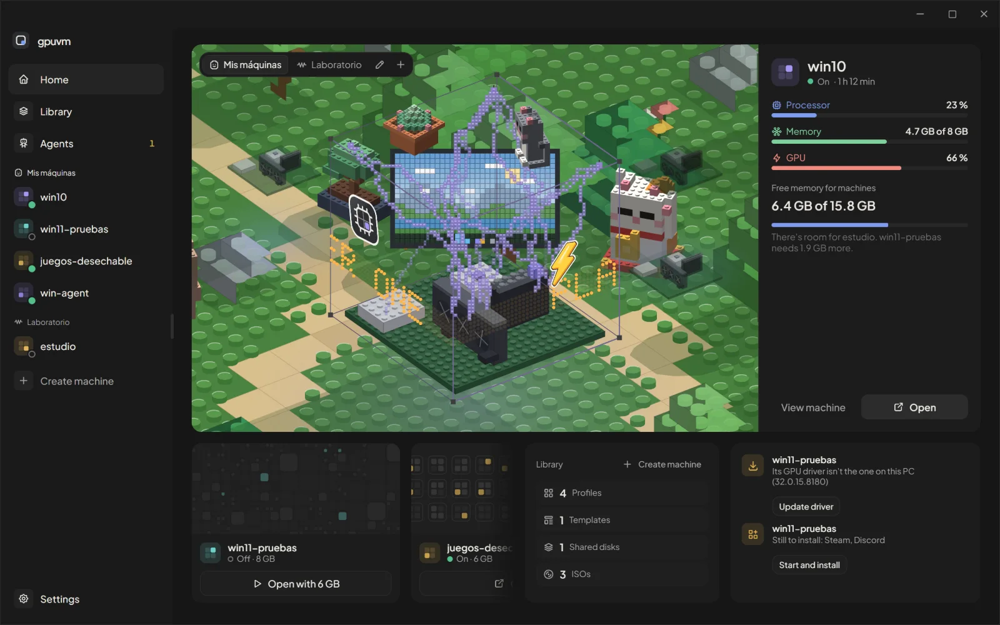
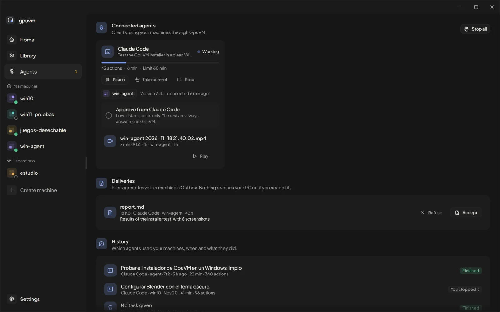
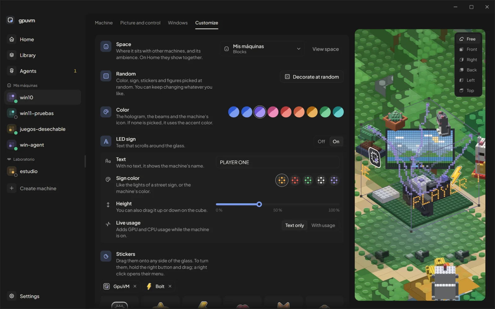
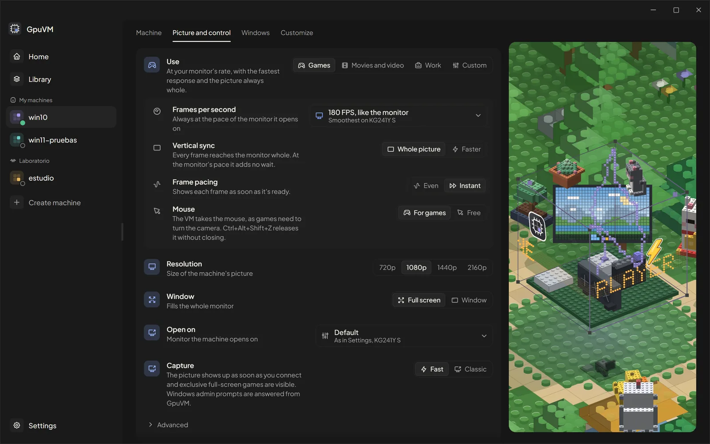
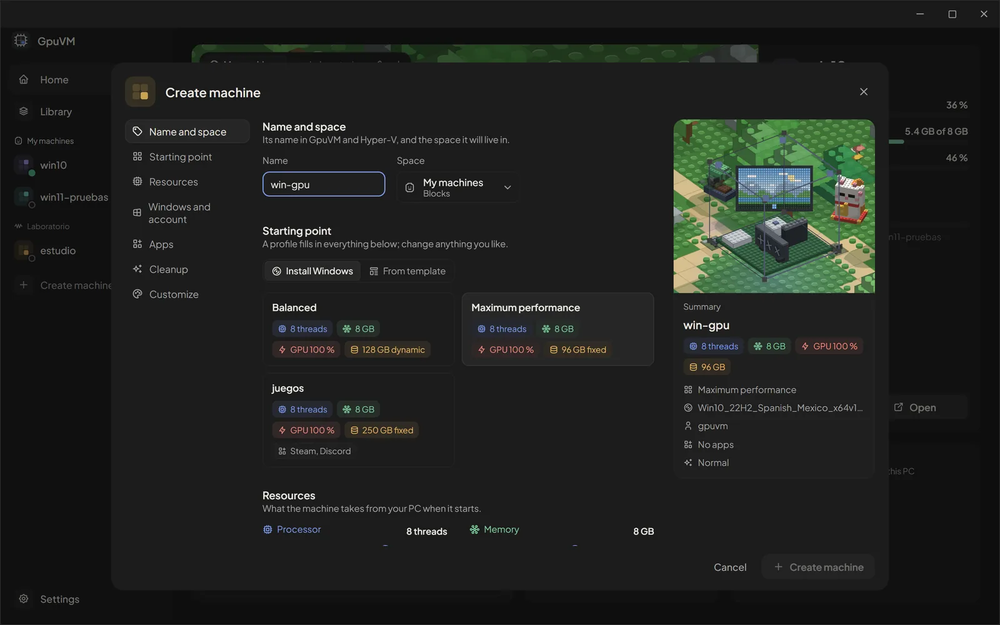
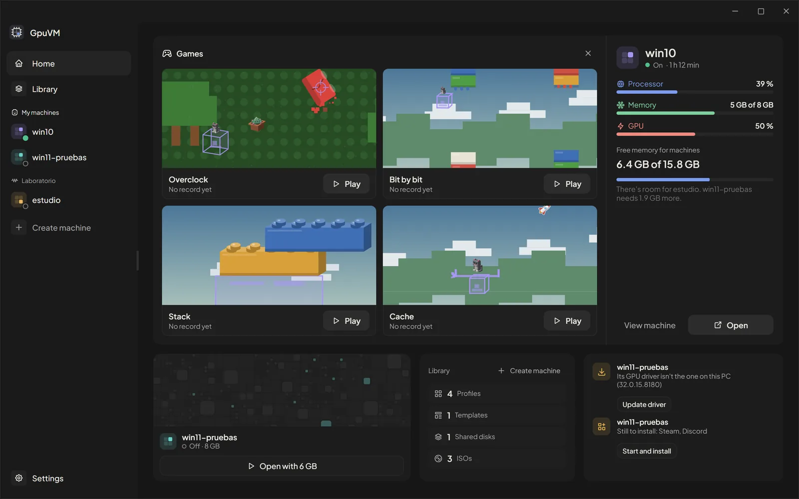
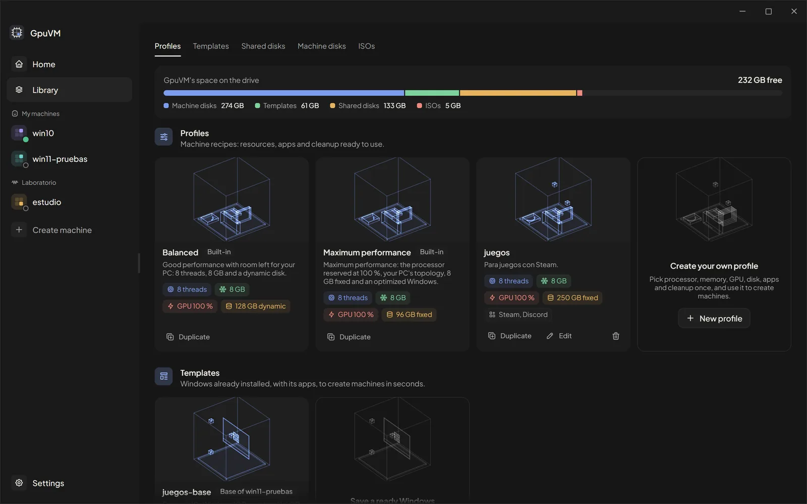
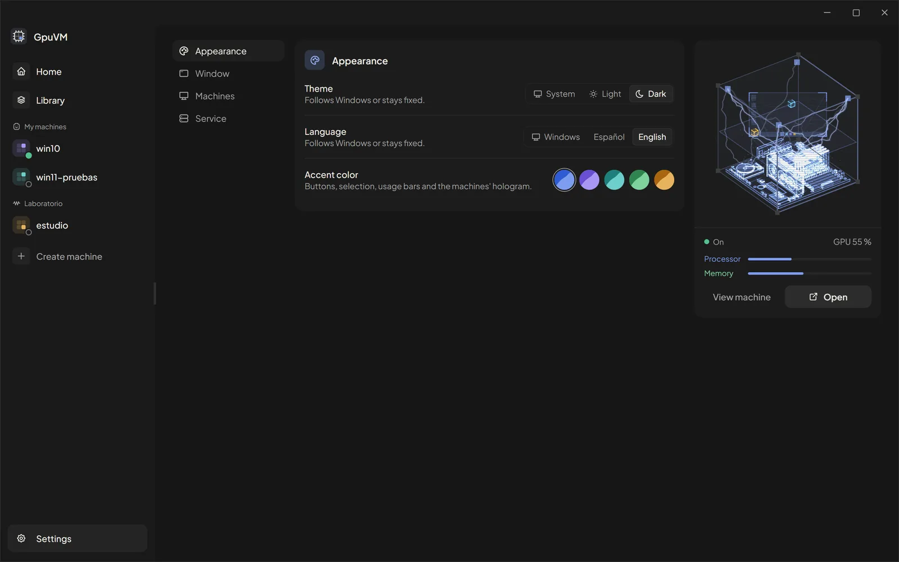

English | [Español](README.es.md)

<p align="center">
  
</p>

<h1 align="center">GpuVM</h1>

<p align="center">
  Windows 10/11 virtual machines that use your own GPU — created, started and streamed in one click.
</p>

<p align="center">
  <a href="https://github.com/alenj0x1/gpuvm/releases"></a>
  <a href="https://gpuvm.alenj.dev/"></a>
  <a href="https://gpuvm.alenj.dev/docs/"></a>
  <a href="CHANGELOG.md"></a>
  <a href="LICENSE"></a>
</p>

<p align="center">
  <a href="https://github.com/alenj0x1/gpuvm/releases/latest"><b>Download for Windows</b></a> · <a href="https://gpuvm.alenj.dev/">Website</a> · <a href="https://gpuvm.alenj.dev/docs/">Documentation</a>
</p>

<p align="center">
  
</p>

## What it does

- **Every machine, a hologram.** Each machine is drawn as a hologram inside a glass cube: motherboard, processor, memory, graphics card and disk, lit by lightning as each piece works, and following what you change before you save. Turn it, zoom it, and decorate it: its own color, an LED sign running around the glass, stickers and toy-brick figures.
- **Spaces with their own world.** Group machines by what they are for; each space is a world of its own (a studio, a motherboard or a world of blocks by day, evening or night), with Home showing one space at a time. Drag machines between spaces and into the order you like.
- **Games while you wait.** Four small games play in the space of machines (*Overclock*, *Bit by bit*, *Stack* and *Cache*), with your machines as the ships, solo or as a team.
- **English and Spanish.** The whole app, the tray and what the module reports follow Windows' language or the one you pick in Settings.
- **Your GPU inside the VM.** Hyper-V GPU partitioning (GPU-P) shares the host GPU with the VM, which runs the same driver as the host. No passthrough, no second GPU.
- **Open it in one click.** "Start and open" starts the VM, waits for Windows, fixes the session and the display, pairs the viewer and opens the stream, drawn and encoded by the GPU (Sunshine + NVENC), with sound. A VM that is already on shows its picture in about 7–10 s.
- **AI agents use your machines.** GpuVM is an MCP server: Claude Code, connected in one click, or any MCP client works in a disposable Windows machine as a standard user while you watch its cursor, clicks and keys over the picture. A click takes control; administrator rights, network and files are approved in GpuVM, never in the chat, and every session is recorded.
- **GpuVM's own viewer.** Built on Moonlight, it shows the machine inside the app or full screen. **Home** (or Ctrl+Alt+Shift+H) keeps the machine connected, so opening it again goes straight back to its picture. The app's animations stop while a picture is shown, leaving the GPU to the machines.
- **Side panel.** Ctrl+Alt+Shift+G opens a board of widgets beside the picture: machines, actions, the picture's numbers, files, clipboard, captures, a clock, the games and the weather, arranged with **Edit**.
- **Low latency, at your monitor's rate.** From a key, click, mouse move or gamepad button to the change on screen takes about 16.6 ms at 120 FPS or more, about 11 ms more than playing locally. The VM streams at your monitor's refresh rate, where V-Sync adds no latency and stutters halve.
- **A use for each machine.** Games, Movies and video or Work set the frame rate, V-Sync, frame pacing and mouse; codec, image quality and the rest can be tuned per machine.
- **Gamepads.** Controllers connected to your PC reach the VM as an Xbox 360 controller (ViGEmBus, installed by GpuVM).
- **Fixes itself.** It copies the GPU driver again when the host driver changes, puts the Windows session back on the GPU display and matches the display resolution to the picture.
- **Create machines without the installer.** Pick an official Windows ISO and a profile: the image is applied straight to a disk and set up unattended.
- **Stats and options.** Live CPU, memory and GPU usage; processors, memory, GPU share and stream quality for each VM.
- **Library.** Your own profiles (processors, memory, GPU, disk, ISO, apps, how the picture opens), the disks kept from deleted VMs to create them again, and the ISOs you used.
- **Templates and shared disks.** Save a VM as a template and create new ones on top of it in seconds; keep your game library on a shared disk that moves between VMs, imported from your PC's Steam library.
- **Clean Windows.** Pick a level (privacy, no extra apps, minimal) to cut telemetry, ads, suggestions, Copilot and preinstalled apps, without touching Defender, Windows Update or the firewall.
- **Apps in one step.** 16 apps (game launchers, browsers, media, Discord, 7-Zip, WinRAR, Proton VPN) with search and categories, installed inside the VM only if signed by their publisher or matching a pinned hash.
- **Administrator prompts in GpuVM.** Windows' administrator prompts in the VM drop from the top of its picture with Allow and Deny, answerable only from your PC. The picture shows a few seconds after connecting, games in exclusive fullscreen too.
- **Files, clipboard and captures.** Drop files on the picture to copy them into the VM, keep your last 8 copies ready to paste, and take screenshots, record or save the last 30 seconds with a shortcut.
- **Restore points, disposable machines, export.** Go back to a restore point in about a second, open a disposable copy of a template that is deleted when it shuts down, and move a machine to another PC as a single `.gpuvm` file.
- **Keeps the host apart.** The app runs without administrator rights, and the viewer runs isolated at Low integrity with a restricted token; a Windows service that only GpuVM's own app can use does the Hyper-V work, and deleting asks for a Windows administrator prompt. The clipboard only goes from the PC to the VM, never back.
- **Labs.** Every performance idea is measured (baseline vs candidate) before it becomes a default.

<p align="center">
  
</p>

<p align="center">
  
  
</p>

<p align="center">
  
  
</p>

<p align="center">
  
  
</p>

## Requirements

- Windows 10/11 Pro, Enterprise, Education or Pro for Workstations, with Hyper-V enabled.
- A GPU that supports partitioning (tested with an NVIDIA GeForce RTX 4060).
- An administrator account on the PC.
- An official Windows 10 or 11 ISO.

Enable Hyper-V once, as administrator, then restart:

```powershell
Enable-WindowsOptionalFeature -Online -FeatureName Microsoft-Hyper-V-All
```

## Install

Download `GpuVM_x.y.z_x64-setup.exe` from [Releases](https://github.com/alenj0x1/gpuvm/releases) and run it. GpuVM installs for every user in Program Files, with its own PowerShell 7 and the **GpuVM** service, which does the Hyper-V work. The app opens without administrator rights; deleting a machine or a disk asks for confirmation in a Windows administrator prompt. Data that changes (labs, downloads) lives in `%ProgramData%\GpuVM`.

## Quick start

1. Open GpuVM and choose **Create machine**: name, Windows ISO, profile, Windows user and password.
2. Wait until it's ready; Windows finishes its setup on its own in a few minutes.
3. Press **Open**. The machine's picture opens inside GpuVM once it is ready.

GpuVM speaks English and Spanish: it follows Windows' language, and **Settings → Appearance → Language** fixes one.

## Documentation

Full guide, CLI reference, architecture and troubleshooting: **[gpuvm.alenj.dev/docs](https://gpuvm.alenj.dev/docs/)** (English and Spanish).

## How it works

| Piece | Role |
|---|---|
| `app/` | Desktop app (Tauri 2 + React), unelevated. `app/host` is the GpuVM service (`gpuvm-host.exe`): it runs `src/bridge.ps1` for the app behind a named pipe. |
| `src/GpuVM/` | PowerShell 7 module: creation, profiles, driver sync, streaming, labs. Backends are swappable (`Backends/`). |
| `guest/` | Scripts that run inside the VM: first boot, optimizations, streaming, display resolution, administrator prompts. |
| `profiles/` | JSON profiles with inheritance (`balanced`, `max-performance`). |
| `streaming/components.json` | Third-party components pinned by version and SHA-256. |
| `viewer/` | GpuVM's viewer, built from the separate [gpuvm-viewer](https://github.com/alenj0x1/gpuvm-viewer) repository and bundled by the installer. |
| `labs/` | Measurements behind each decision. |

## Development

```powershell
npm --prefix app install
npm --prefix app run dev          # UI with sample data in the browser (?mock=empty, ?mock=noservice, ?vms=30)
npm --prefix app run i18n         # every Spanish text has its English (app/src/i18n/en)
node tools/screenshots/shoot.mjs  # screenshots for the README, docs and website (needs the dev server on :1430)
npm --prefix app run tauri build  # installer in app/src-tauri/target/release/bundle/nsis/
Invoke-Pester ./tests             # module tests, no administrator needed
pwsh -File tests/e2e/overlays.ps1 # end-to-end: what the person sees over a machine (installed build; required to release)
npm --prefix docs run dev         # documentation site
node scripts/site/changelog.mjs   # website (site/): what's new, from the changelogs
npm --prefix app run build:embed  # website: the app's live components (site/assets/embed.js)
python scripts/release.py 0.4.1   # release: changelog, versions, commit and tag (--dry-run, --next)
```

Changes go under **Unreleased** in `CHANGELOG.md` and **Sin publicar** in `CHANGELOG.es.md` until they are released.

The CLI covers the same features: `./gpuvm.ps1 check`, `new`, `list`, `sync-driver`, `set`, `remove`, `lab-*` (see the docs).

## Third-party components

The installer carries [PowerShell 7](https://github.com/PowerShell/PowerShell) (MIT), pinned by version and SHA-256, to run the module.

GpuVM downloads and installs these inside the VM, verified by SHA-256:

- [Sunshine](https://github.com/LizardByte/Sunshine) (GPL-3.0) — game stream host.
- [Virtual Display Driver](https://github.com/VirtualDrivers/Virtual-Display-Driver) — virtual monitor drawn by the GPU.
- [nefcon](https://github.com/nefarius/nefcon) — driver installer.
- [usbip-win2](https://github.com/vadimgrn/usbip-win2) (BSD-2-Clause) — USB/IP client with Microsoft-signed drivers; it plugs in GpuVM's own USB speaker inside the VM.
- [ViGEmBus](https://github.com/nefarius/ViGEmBus) (BSD-3-Clause) — virtual gamepad bus driver, for the controllers the viewer forwards.

On the host, GpuVM's viewer is built on [Moonlight](https://github.com/moonlight-stream/moonlight-qt) (moonlight-qt, GPL-3.0). The fork is kept in the separate [gpuvm-viewer](https://github.com/alenj0x1/gpuvm-viewer) repository (branch `gpuvm`), under GPL-3.0, and the installer bundles it.

The app catalog shows each app's own icon, taken from its official installer or website; the icons and names are trademarks of their owners and only identify their apps.

## Changelog

See [CHANGELOG.md](CHANGELOG.md).

## License

[MIT](LICENSE). Third-party components keep their own licenses.
