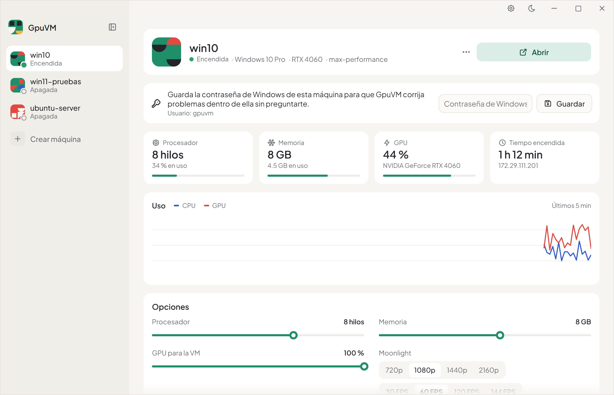
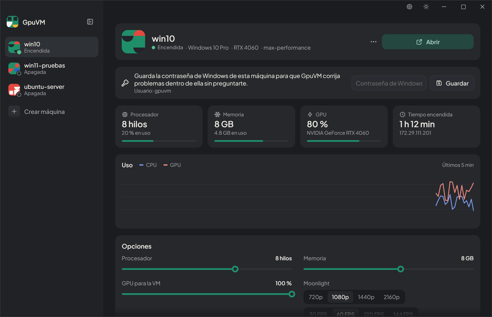
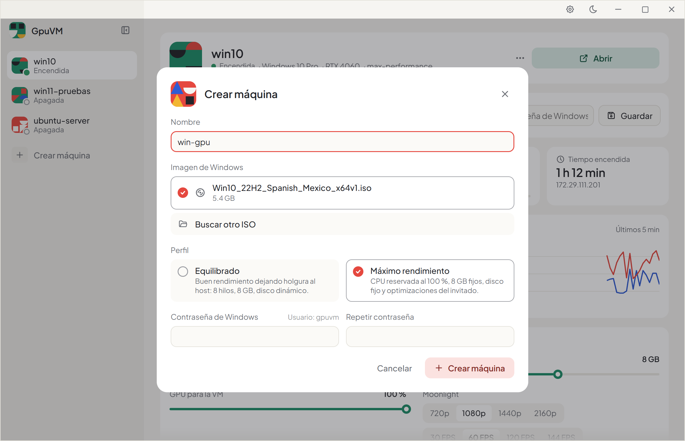
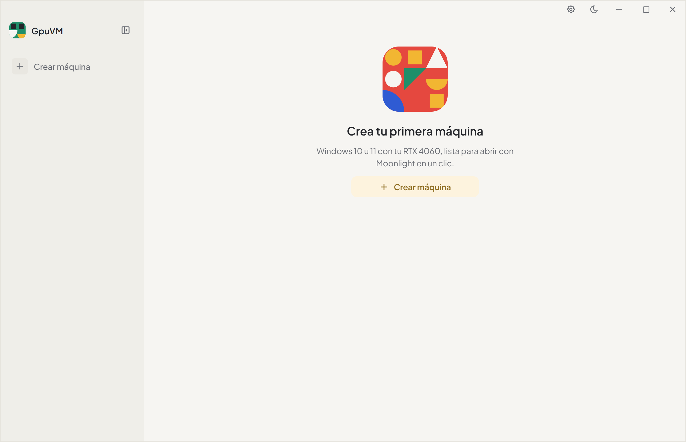

English | [Español](README.es.md)

<p align="center">
  
</p>

<h1 align="center">GpuVM</h1>

<p align="center">
  Windows 10/11 virtual machines that use your own GPU — created, started and streamed in one click.
</p>

<p align="center">
  <a href="https://github.com/alenj0x1/gpuvm/releases"></a>
  <a href="https://alenj0x1.github.io/gpuvm/"></a>
  <a href="CHANGELOG.md"></a>
  <a href="LICENSE"></a>
</p>

<p align="center">
  
  
</p>

## What it does

- **Your GPU inside the VM.** Hyper-V GPU partitioning (GPU-P) shares the host GPU with the VM, which runs the same driver as the host. No passthrough, no second GPU.
- **Open it in one click.** "Start and open" starts the VM, waits for Windows, fixes the session and the display, pairs Moonlight and opens the stream, drawn and encoded by the GPU (Sunshine + NVENC), with sound.
- **Fixes itself.** It copies the GPU driver again when the host driver changes, puts the Windows session back on the GPU display and matches the display resolution to Moonlight.
- **Create machines without the installer.** Pick an official Windows ISO and a profile: the image is applied straight to a disk and set up unattended.
- **Stats and options.** Live CPU, memory and GPU usage; processors, memory, GPU share and stream quality for each VM.
- **Library.** Your own profiles (processors, memory, GPU, disk, ISO, apps, how Moonlight opens), the disks kept from deleted VMs to create them again, and the ISOs you used.
- **Clean Windows.** Pick a level (privacy, no extra apps, minimal) to cut telemetry, ads, suggestions, Copilot and preinstalled apps, without touching Defender, Windows Update or the firewall.
- **Apps in one step.** 16 apps (game launchers, browsers, media, Discord, 7-Zip, WinRAR, Proton VPN) with search and categories, installed inside the VM only if signed by their publisher or matching a pinned hash.
- **Games in exclusive fullscreen.** A per-VM capture option shows them instead of a black screen; paste text from the PC into the VM with one button.
- **Keeps the host apart.** Moonlight runs without administrator rights, and the clipboard only goes from the PC to the VM, never back.
- **Labs.** Every performance idea is measured (baseline vs candidate) before it becomes a default.

<p align="center">
  
  
</p>

## Requirements

- Windows 10/11 Pro, Enterprise, Education or Pro for Workstations, with Hyper-V enabled.
- A GPU that supports partitioning (tested with an NVIDIA GeForce RTX 4060).
- [PowerShell 7](https://learn.microsoft.com/powershell/scripting/install/installing-powershell-on-windows) (MSI or Microsoft Store).
- An official Windows 10 or 11 ISO.

Enable Hyper-V once, as administrator, then restart:

```powershell
Enable-WindowsOptionalFeature -Online -FeatureName Microsoft-Hyper-V-All
```

## Install

Download `GpuVM_x.y.z_x64-setup.exe` from [Releases](https://github.com/alenj0x1/gpuvm/releases) and run it. GpuVM installs for every user in Program Files and asks for administrator rights when it opens, because Hyper-V requires them. Data that changes (labs, downloads) lives in `%ProgramData%\GpuVM`.

## Quick start

1. Open GpuVM and choose **Crear máquina** (Create machine): name, Windows ISO, profile and the Windows password.
2. Wait until it's ready; Windows finishes its setup on its own in a few minutes.
3. Press **Abrir** (Start and open). Moonlight opens with the VM.

The interface is in Spanish for now.

## Documentation

Full guide, CLI reference, architecture and troubleshooting: **[alenj0x1.github.io/gpuvm](https://alenj0x1.github.io/gpuvm/)** (English and Spanish).

## How it works

| Piece | Role |
|---|---|
| `app/` | Desktop app (Tauri 2 + React). Talks to PowerShell through `src/bridge.ps1`. |
| `src/GpuVM/` | PowerShell 7 module: creation, profiles, driver sync, streaming, labs. Backends are swappable (`Backends/`). |
| `guest/` | Scripts that run inside the VM: first boot, optimizations, streaming, display resolution. |
| `profiles/` | JSON profiles with inheritance (`balanced`, `max-performance`). |
| `streaming/components.json` | Third-party components pinned by version and SHA-256. |
| `labs/` | Measurements behind each decision. |

## Development

```powershell
npm --prefix app install
npm --prefix app run dev          # UI with sample data in the browser (?mock=empty, ?mock=noadmin)
npm --prefix app run tauri build  # installer in app/src-tauri/target/release/bundle/nsis/
Invoke-Pester ./tests             # module tests, no administrator needed
npm --prefix docs run dev         # documentation site
python scripts/release.py 0.4.0   # release: changelog, versions, commit and tag (--dry-run, --next)
```

Changes go under **Unreleased** in `CHANGELOG.md` and **Sin publicar** in `CHANGELOG.es.md` until they are released.

The CLI covers the same features: `./gpuvm.ps1 check`, `new`, `connect`, `list`, `sync-driver`, `set`, `remove`, `lab-*` (see the docs).

## Third-party components

GpuVM downloads and installs these inside the VM, verified by SHA-256:

- [Sunshine](https://github.com/LizardByte/Sunshine) (GPL-3.0) — game stream host.
- [Virtual Display Driver](https://github.com/VirtualDrivers/Virtual-Display-Driver) — virtual monitor drawn by the GPU.
- [nefcon](https://github.com/nefarius/nefcon) — driver installer.
- [usbip-win2](https://github.com/vadimgrn/usbip-win2) (BSD-2-Clause) — USB/IP client with Microsoft-signed drivers; it plugs in GpuVM's own USB speaker inside the VM.

On the host it uses [Moonlight](https://moonlight-stream.org) (GPL-3.0), installed with winget.

The app catalog shows each app's own icon, taken from its official installer or website; the icons and names are trademarks of their owners and only identify their apps.

## Changelog

See [CHANGELOG.md](CHANGELOG.md).

## License

[MIT](LICENSE). Third-party components keep their own licenses.
